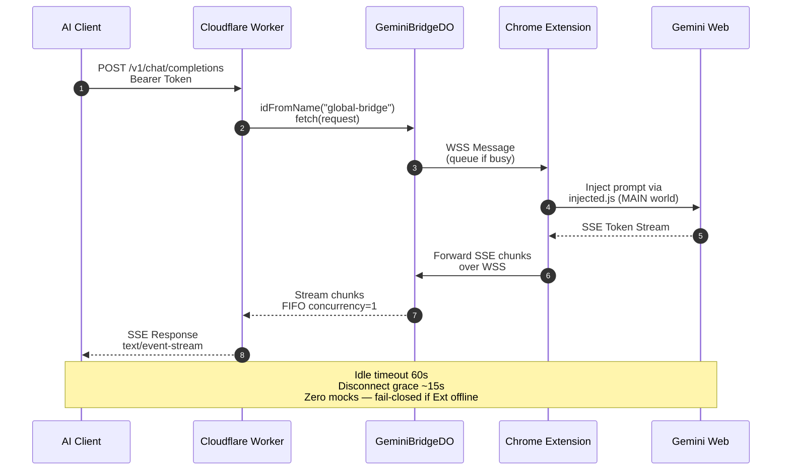
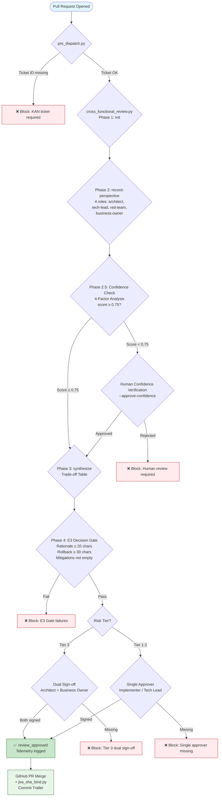
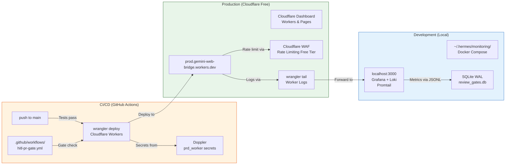
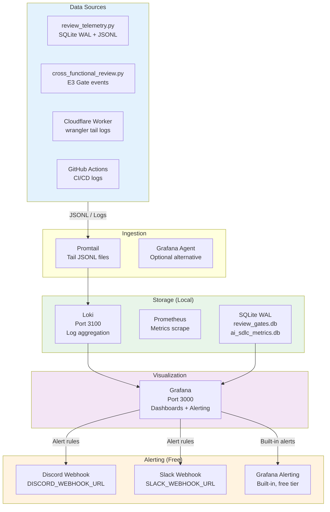

# Gemini Web Bridge — System Architecture (Mermaid Diagrams)

> เอกสารนี้รวมแผนภาพสถาปัตยกรรมทั้งหมดของระบบ Gemini Web Bridge (v4.2.0) เขียนด้วย **Mermaid.js** รองรับการเรนเดอร์บน GitHub ฟรี ไม่ต้องติดตั้งเครื่องมือเพิ่ม
>
> spec รายละเอียดดูที่ `ARCHITECTURE.md`

---

## 1. C4 Component Diagram (ระดับระบบ)

```mermaid
graph TB
    subgraph Clients["AI Clients (HTTPS)"]
        A[Hermes Agent]
        B[Cursor]
        C[Cline]
        D[Claude Code]
        E[Python SDK]
    end

    subgraph Edge["Cloudflare Edge"]
        F[Cloudflare Worker<br/>gemini-web-bridge<br/>/v1 | /mcp | /bridge]
    end

    subgraph DO["Cloudflare Durable Objects"]
        G[GeminiBridgeDO<br/>Single Instance<br/>idFromName("global-bridge")]
        H[BridgeRouterDO<br/>Multi-Session<br/>idFromName("router")]
    end

    subgraph Extension["Chrome Extension (MV3)"]
        I[background.js<br/>Leader Tab]
        J[content.js]
        K[injected.js<br/>MAIN World]
    end

    subgraph Gemini["Google Gemini Web Session"]
        L[gemini.google.com/app<br/>Authenticated Session]
        M[NotebookLM<br/>Document-Grounded]
    end

    subgraph Fallback["GCP Hybrid Fallback"]
        N[GCP Vertex AI<br/>Optional Fallback]
    end

    Clients -->|Bearer Token<br/>CLIENT_API_KEY| F
    F --> G
    F --> H
    G <-->|WSS Protocol v2| I
    I --> J
    J --> K
    K -->|CSRF Token<br/>SNlM0e (MAIN world only)| L
    K -.->|Document Grounding| M
    G -.->|GCP Fallback<br/>GEMINI_API_KEY| N

    style Clients fill:#e1f5fe,stroke:#01579b
    style Edge fill:#fff3e0,stroke:#e65100
    style DO fill:#f3e5f5,stroke:#4a148c
    style Extension fill:#e8f5e9,stroke:#1b5e20
    style Gemini fill:#fce4ec,stroke:#880e4f
    style Fallback fill:#fff8e1,stroke:#f57f17
```

---

## 2. Sequence Diagram — SSE Streaming & WebSocket Handshake



---

## 3. HITL & E3 Approval Flow



---

## 4. Deployment Architecture (Cloudflare Free Tier)



---

## 5. Observability Stack (Free, Local Docker)



---

## 6. ตารางอ้างอิงไฟล์ ADR

| ADR | ไฟล์ | หัวข้อ | สถานะ |
|-----|-------|--------|--------|
| 0001 | `docs/adr/0001-cloudflare-durable-objects-bridge.md` | สถาปัตยกรรมหลัก v4.2.0: Worker + GeminiBridgeDO + MV3 Extension | ✅ สร้างแล้ว |
| 0002 | `docs/adr/0002-multi-session-load-balancing.md` | การกระจายโหลดหลาย Session (BridgeRouterDO) | ✅ สร้างแล้ว |
| 0003 | `docs/adr/0003-context-persistence-vector-memory.md` | Context Persistence: D1 + Vectorize | ✅ สร้างแล้ว |
| 0004 | `docs/adr/0004-session-health-auto-recovery.md` | Heartbeat & Auto-reconnect ของ Chrome Extension | ✅ สร้างแล้ว |

---

## 7. Third-Party & App Services Inventory (Free Tier เท่านั้น)

| หมวดหมู่ | บริการ | Tier | ใช้เพื่ออะไร | ที่ตั้ง |
|----------|--------|------|-------------|---------|
| Edge Runtime | Cloudflare Workers | Free | API Gateway, Durable Objects | `cloudflare-worker/` |
| Secrets | Doppler | Free | `prd_worker` config secrets | `~/.hermes/.env` |
| CI/CD | GitHub Actions | Free | Build, test, deploy | `.github/workflows/` |
| Monitoring | Grafana + Loki | Free (self-hosted) | Dashboards, alerting | `~/.hermes/monitoring/` |
| Database | SQLite WAL | Free | Telemetry, gate events | `~/.hermes/DIPS` |
| Notification | Discord / Slack Webhook | Free | HITL alerts, worker alerts | Doppler secret |
| Version Control | GitHub | Free | Repo, PR, Issues | `github.com/kimlenglim` |

---

*เอกสารนี้จัดเก็บใน Git ร่วมกับโค้ด ตามหลักการ **Read-Before-Modify** — AI Agent ต้องอ่านไฟล์นี้ก่อนแก้ไขสถาปัตยกรรมใดๆ ในระบบ*